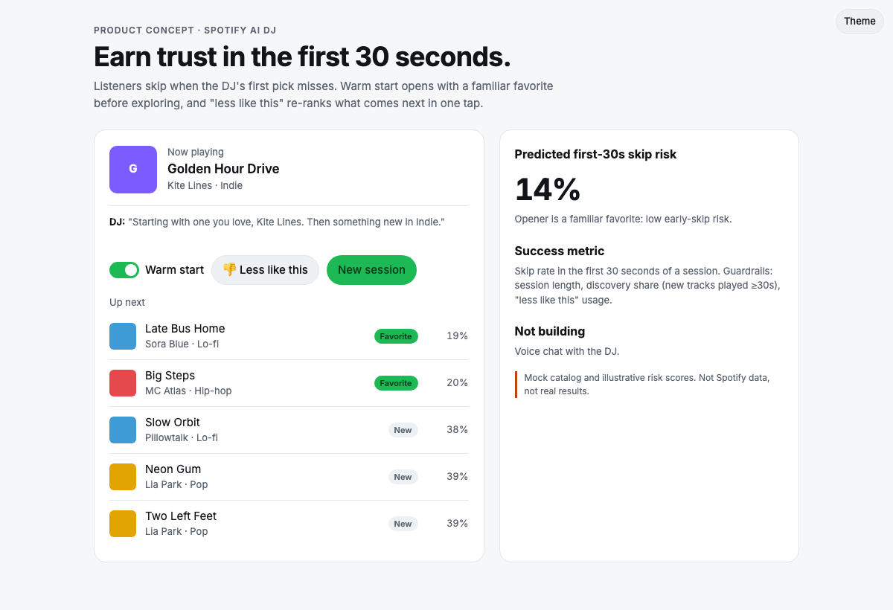
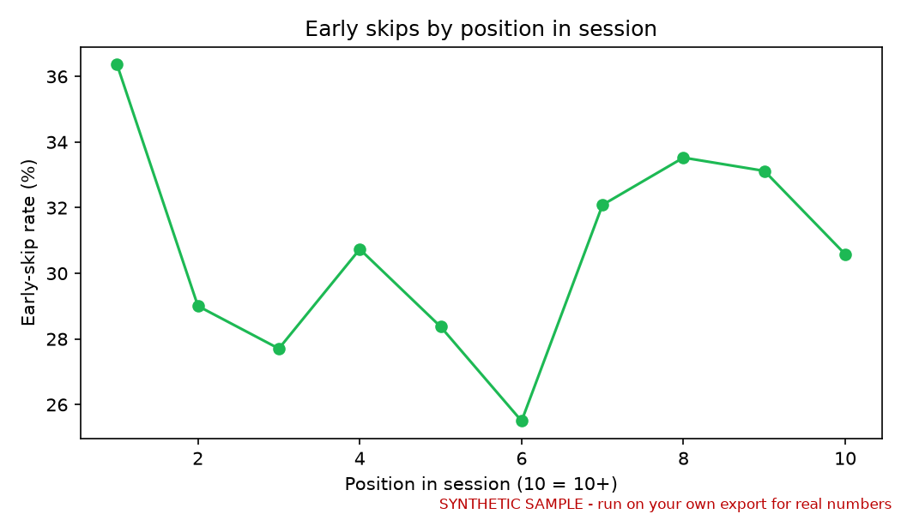
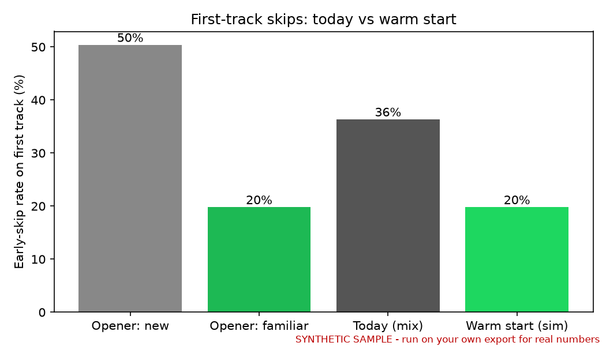

# Spotify AI DJ Warm Start: earn the listener's trust in the first 30 seconds

> **PM case study + working prototype** · Music streaming / AI personalization · Spotify Extended Streaming History schema (synthetic sample included; run it on your own export)



**▶ [Live demo](https://akhilesh360.github.io/spotify-dj-warm-start/)** · **🎬 [60-second walkthrough](docs/demo.webm)** · [Demo script](docs/demo-script.md)

## 1. User and problem
People who open AI DJ for low-effort listening while commuting, working or cooking. They want music they like right away, and they are open to new music once they trust the DJ. Today the DJ often opens by exploring. When that first pick misses, people skip it, and an early miss tells them the DJ doesn't know them.

## 2. Product goal
More sessions start with a song the listener keeps playing, so they trust the DJ enough to stay for the new music that follows.

## 3. Solution and trade-offs
- **Warm start:** the first song is a familiar favorite (played 5+ times before). Exploration starts on the second song.
- **"Less like this":** one tap skips the song and pushes similar picks down the queue right away.
- **Trade-off:** warm start gives up a little discovery at the open to gain trust. The discovery guardrail checks whether that costs us discovery overall.
- **Not built: voice chat with the DJ.** It costs a lot to build, it's hard to get right, and it doesn't fix the first-pick miss. A single tap gives a clearer signal for much less effort.

## 4. North Star metric
**First-30-second skip rate:** the share of DJ sessions where the first track plays for less than 30 s. Lower is better.

## 5. Supporting metrics
- **Adoption:** share of DJ sessions where warm start runs (eligible listeners with 1+ favorite).
- **Engagement:** tracks played 30 s or more per DJ session.
- **Retention:** share of DJ users who return to DJ within 7 days.
- **Conversion:** share of new tracks played in DJ that are later saved or added to a playlist.

## 6. Guardrail metrics
- **Discovery share** (new tracks played 30 s or more): no drop of more than 2 points.
- **Session length:** no drop of more than 1%.
- **DJ opt-outs / turn-offs:** no increase of more than 0.5 points.
- **"Less like this" rate:** watch it for signs of repetition fatigue.

Thresholds are proposed starting points to be set with the data team. They are not benchmarks.

## 7. Prioritization
- **Warm start came first:** it hits the highest-leverage moment, every session's first song. The change is small, ranking only, and it reuses play history Spotify already has.
- **"Less like this" second:** it is cheap, and it creates a feedback signal.
- **Voice chat:** high effort with an indirect effect. Deprioritized.
- **"Better exploration model":** high effort, and it doesn't remove the open-on-the-unknown risk. Deprioritized.

## 8. Experiment and learning
**Test:** A/B test randomized by user, current DJ opener vs warm start, run for 2 weeks.
**Decision rule:** ship if the north-star metric drops by a statistically significant amount and no guardrail crosses its threshold. If discovery falls, try warm start only on the first session of each day.
**Next:** make warm start adaptive (skip it for listeners who reward exploration), carry "less like this" into later sessions, and solve the opener for brand-new users with no favorites.

**What this repo shows.** `src/analyze.py` reads a Spotify Extended Streaming History export. It splits listening into sessions (a gap of more than 30 minutes starts a new one) and measures early skips by position in the session and for familiar vs new tracks. It then simulates warm start. **The repo ships no real data.** On the bundled **synthetic sample** (231 sessions), the first-track early-skip rate is 36.4% today and 19.8% in the simulation. The generator builds in that pattern, so these numbers only show the pipeline works. On real data the simulation is an observational upper bound, not a causal effect, which is why the A/B test is needed.




---
**How to run it**
```bash
python3 -m venv .venv && .venv/bin/pip install -r requirements.txt
.venv/bin/python data/sample_generator.py && .venv/bin/python src/analyze.py data/sample_streaming_history.json --synthetic
# your data: Spotify Account → Privacy → "Extended streaming history" → copy to data/my_*.json (git-ignored)
.venv/bin/python src/analyze.py data/my_*.json --out out/
```
Demo: open `docs/index.html`. No build step.

**About**: Built by Sai Akhilesh Veldi. [Portfolio](#) · [LinkedIn](https://www.linkedin.com/in/akhileshsai/) · MIT License · Not affiliated with Spotify.
